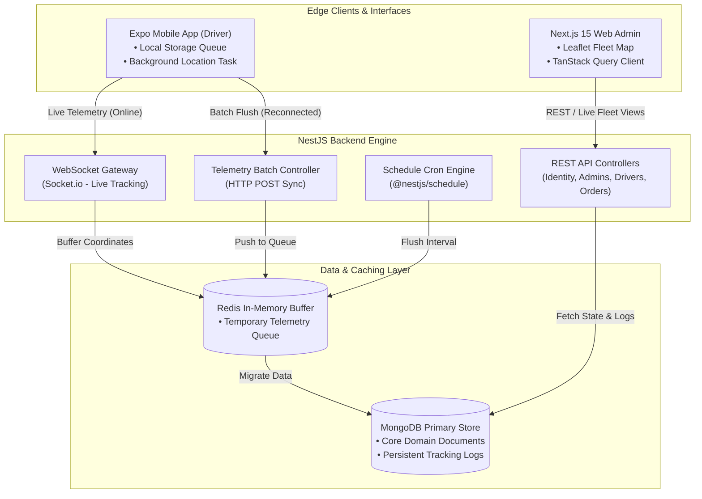
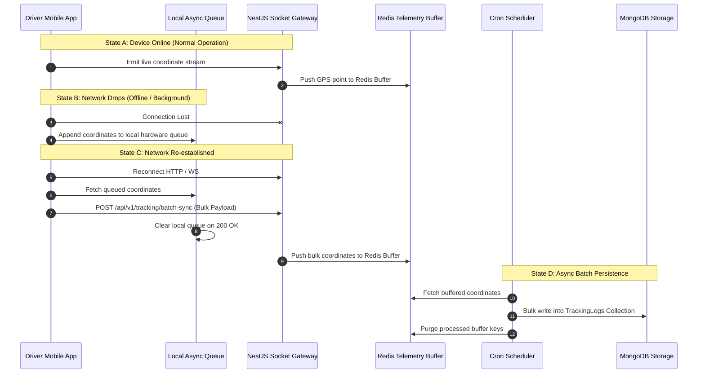

# LogiSync-X | System Architecture & Data Models

This document provides a comprehensive technical breakdown of the **LogiSync-X** monorepo architecture, offline telemetry synchronization flow, and Mongoose database schemas.

---

## 1. High-Level System Architecture

LogiSync-X uses a monorepo topology powered by Turborepo, enforcing strict separation of concerns between edge client applications (Mobile and Web Admin) and the NestJS monolithic backend engine.



---

## 2. Offline-to-Online Telemetry Sequence Flow



---

## 3. Entity Relationship Diagram (ERD)

```mermaid
erDiagram
    IDENTITY {
        ObjectId _id PK
        string email UK
        string phone
        string passwordHash "select: false"
        string status "PENDING | ACTIVE | DEACTIVE"
        string role "DRIVER | ADMIN"
    }

    ADMIN {
        ObjectId _id PK
        ObjectId identityId FK
        string name
    }

    DRIVER {
        ObjectId _id PK
        ObjectId identityId FK
        string name
        string vehicleNumber
        string dutyStatus "OFFLINE | AVAILABLE | ON_TRIP"
    }

    ORDER {
        ObjectId _id PK
        string customerName
        ObjectId assignedDriverId FK
        string deliveryAddress
        string pickupLocation
        string status "PENDING | ASSIGNED | PICKED_UP | IN_TRANSIT | DELIVERED | CANCELLED"
        string trackingId UK
    }

    TRACKING_LOG {
        ObjectId _id PK
        ObjectId orderId FK
        ObjectId driverId FK
        json[] coordinates "lat, lng, timestamp"
        boolean isActiveStream
    }

    IDENTITY ||--O| ADMIN : "references"
    IDENTITY ||--O| DRIVER : "references"
    DRIVER ||--o{ ORDER : "assigned_to"
    ORDER ||--o{ TRACKING_LOG : "has_logs"
    DRIVER ||--o{ TRACKING_LOG : "generates"
```



---

## 4. Database Domain Models & Schemas

### Enums

```typescript
export enum Role {
  DRIVER = 'DRIVER',
  ADMIN = 'ADMIN',
}

export enum IdentityStatus {
  PENDING = 'PENDING',
  ACTIVE = 'ACTIVE',
  DEACTIVE = 'DEACTIVE',
}

export enum DutyStatus {
  OFFLINE = 'OFFLINE',
  AVAILABLE = 'AVAILABLE',
  ON_TRIP = 'ON_TRIP',
}

export enum OrderStatus {
  PENDING = 'PENDING',
  ASSIGNED = 'ASSIGNED',
  PICKED_UP = 'PICKED_UP',
  IN_TRANSIT = 'IN_TRANSIT',
  DELIVERED = 'DELIVERED',
  CANCELLED = 'CANCELLED',
}
```

### Core Schema Definitions

#### 1. Identity Schema
* **Description:** Central authentication record holding credentials, contact details, role configuration, and account lifecycle status.
* **Fields:**
  * `email`: String (Required, Unique, Lowercase, Trimmed)
  * `phone`: String (Required, Trimmed)
  * `passwordHash`: String (Required, `select: false` for security)
  * `role`: String (Enum: `Role`, Default: `DRIVER`)
  * `status`: String (Enum: `IdentityStatus`, Default: `PENDING`)

#### 2. Admin & Driver Schemas
* **Description:** Extended profile entities mapped directly to an explicit `Identity` parent document via standard relational references.
* **Fields (Admin):**
  * `identityId`: ObjectId (Required, Ref: `Identity`, Unique)
  * `name`: String (Required, Trimmed)
* **Fields (Driver):**
  * `identityId`: ObjectId (Required, Ref: `Identity`, Unique)
  * `name`: String (Required, Trimmed)
  * `vehicleNumber`: String (Required, Uppercase, Trimmed)
  * `dutyStatus`: String (Enum: `DutyStatus`, Default: `OFFLINE`)

#### 3. Order Schema
* **Description:** Active logistics dispatch logs tracks routing coordinates, individual state transitions, customer descriptors, and active delivery assignments.
* **Fields:**
  * `trackingId`: String (Required, Unique, Automated-Generation)
  * `customerName`: String (Required, Trimmed)
  * `pickupLocation`: String (Required)
  * `deliveryAddress`: String (Required)
  * `assignedDriverId`: ObjectId (Optional, Ref: `Driver`, Default: `null`)
  * `status`: String (Enum: `OrderStatus`, Default: `PENDING`)

#### 4. TrackingLog Schema (TimeSeries Structure)
* **Description:** High-frequency spatial database optimized for storing coordinate arrays emitted via active edge tracking streams.
* **Fields:**
  * `orderId`: ObjectId (Required, Ref: `Order`, Index: true)
  * `driverId`: ObjectId (Required, Ref: `Driver`, Index: true)
  * `isActiveStream`: Boolean (Default: `true`)
  * `coordinates`: Array of Subdocuments:
    * `lat`: Number (Required)
    * `lng`: Number (Required)
    * `timestamp`: Date (Required, Default: `Date.now`)
